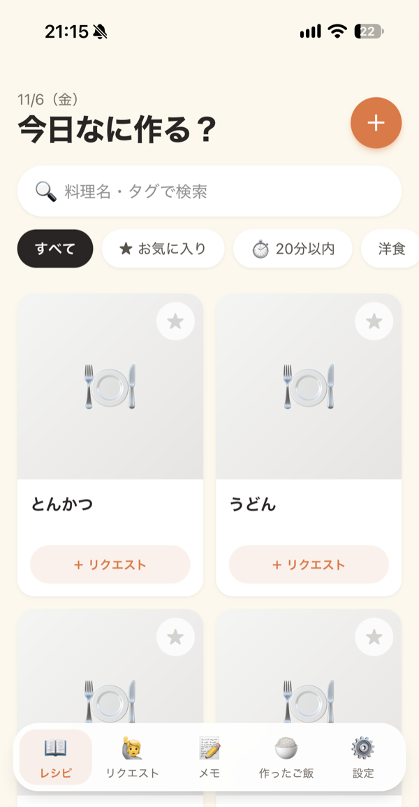
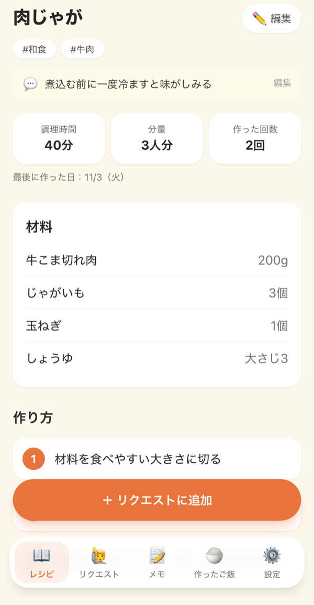
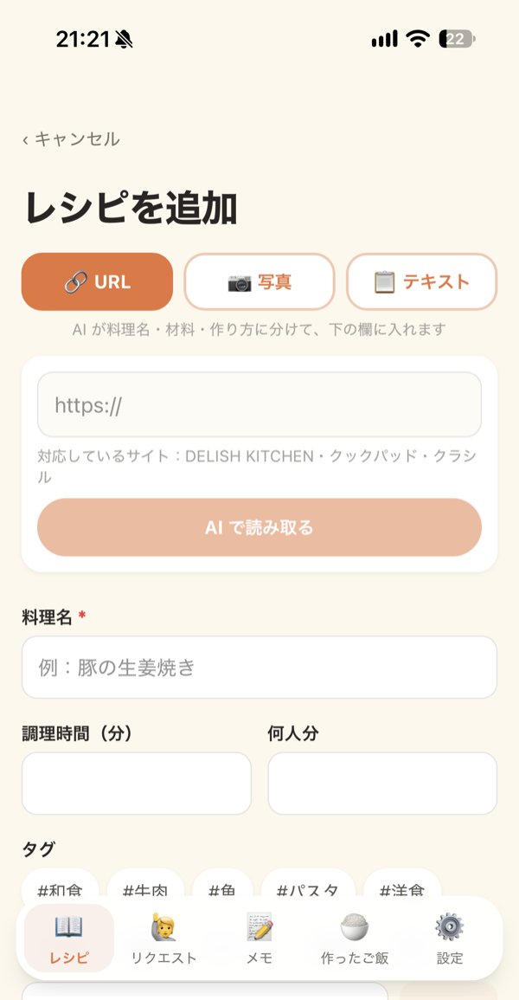
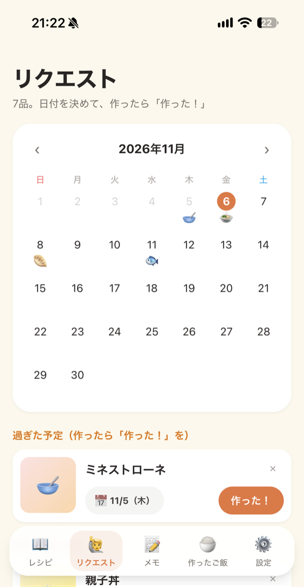
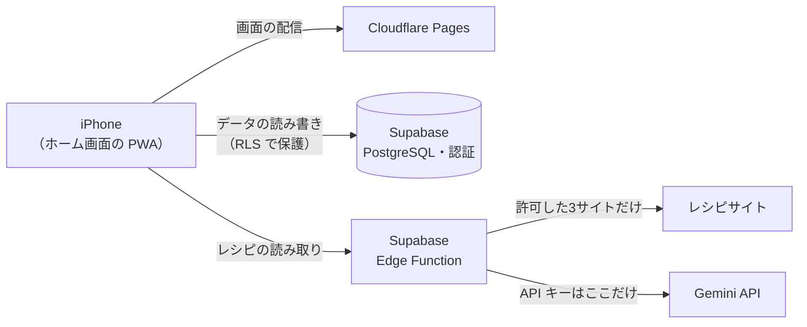

# なに食べたい？

夫婦2人で使う、料理レシピの共有アプリです。iPhone のホーム画面に追加して使う PWA として作り、実際に毎日使っています。

レシピサイトの URL・写真・文章から AI でレシピを取り込めます。リクエストに入れた料理は、カレンダーで作る日を決められます。

- **利用者**：自分と妻の2人（どちらも iPhone）
- **体制**：1人で企画・設計・開発・運用
- **費用**：0円（すべて無料枠の範囲で運用）
- **バージョン**：v1.1（[リリース一覧](https://github.com/tomoyakawana/RECIPE/releases)）

> 新規登録は閉じているため、本番のアプリは2人のアカウントでしか使えません。

| レシピ一覧 | レシピ詳細 | AI で取り込む | リクエスト |
|:---:|:---:|:---:|:---:|
|  |  |  |  |

※ スクリーンショットは、開発用のダミーデータで撮影したものです。

---

## 主な機能

| 画面 | できること |
|---|---|
| **レシピ** | 一覧・検索、タグ・お気に入り・「⏱ 20分以内」での絞り込み。詳細では材料・作り方と、夫婦で共有する「ひとことメモ」を見られる |
| **追加・編集** | **AI で取り込む**：レシピサイトの URL、写真（スクショ）、コピーした文章から、料理名・材料・作り方・タグを読み取って入力欄に入れる。保存は人が確認してから |
| **リクエスト** | 食べたい料理を入れて、カレンダーで作る日を決める。作ったら「作った！」で記録する |
| **シークレットモード** | 予定（作る日）を相手に隠す。妻の「何をいつ作るかはサプライズにしたい」という要望から作った |
| **メモ** | 買い物リストと、夫婦で共有するメモ |
| **作ったご飯** | 作った記録の一覧 |

## 技術

| 分類 | 使っているもの | 選んだ理由 |
|---|---|---|
| フロント | React 19 / TypeScript / Vite / Tailwind CSS v4 | React は実務で経験がある。TypeScript はこのアプリで新しく身につけた |
| PWA | vite-plugin-pwa | ネイティブアプリ（Swift など）は配布に有料の登録が必要で、「費用0円」と両立しないため |
| データ取得 | TanStack Query | キャッシュ・再取得・保存中の状態を任せる。サーバーを正として、端末側はキャッシュとして扱う（iOS の Safari は端末の保存データを消すことがあるため） |
| バックエンド | Supabase（PostgreSQL・認証・Edge Functions〈Deno〉） | 中身が PostgreSQL で、SQL の知識がそのまま使える。自前のサーバーを持たずに済む |
| AI | Gemini API | レシピの読み取りに使う。出力の形を JSON のスキーマで決めて返させる |
| ホスティング | Cloudflare Pages | main は本番、develop はプレビューとして自動でデプロイ |
| CI | GitHub Actions | PR のたびに lint・ビルド（型チェック）・Edge Function の型チェック |

### 構成



## 工夫したところ

### AI の読み取りを安定させる
- URL から取り込むときは、ページの HTML を丸ごと AI に渡さず、レシピサイトが載せている**構造化データ（schema.org の JSON-LD）を先に取り出して、必要な部分だけ渡す**。読み取りが速く、正確になり、無料枠の消費も減る
- AI の返す形は JSON のスキーマで決め、受け取った後も **Zod で検証**する。形が崩れた結果がフォームに入らないようにしている
- 読み取った結果はフォームに入れるだけで、保存は人が確認してから

### セキュリティ
- **SSRF 対策**：サーバーが外部の URL を取りに行くので、取りに行く先を**許可リストの3サイトだけ**にしている。https だけを許可し、リダイレクトの行き先も1回ずつ確かめる。タイムアウトと読み込むサイズの上限も付けている
- **秘密情報はサーバー側だけ**：Gemini の API キーは Edge Function の Secrets にだけ置き、フロントにも git にも入れない
- **DB の権限**：すべてのテーブルに RLS を有効にし、GRANT もテーブルごとに必要な分だけ付けている。DB 関数は実行できるロールを絞っている
- **新規登録は閉じている**：アカウントは夫婦の2つだけ
- 本番に出す前のチェックリストを用意して、機能を足すたびに確認している（[HANDOFF.md](HANDOFF.md) の 16）

### 費用0円で運用する
- 料金・無料枠は変わるので、決めるときは公式のページで確かめて記録している
- AI の取り込みは、写真よりデータの小さい「文章」や「URL」から読めるようにして、無料枠を節約している

### 本番のデータを守る開発環境
- `npm run dev` はローカルの Supabase（Docker）とダミーデータで動く。開発中に本番のデータ（妻の予定など）に触れない
- DB の変更は、すべてマイグレーションのファイルで管理する
- SQL のテストを用意し、素の PostgreSQL の上でマイグレーションから流して確かめられる（`supabase/tests/`）

## 開発の進め方

1人の開発でも、チームでの開発と同じ流れで進めています。

1. やることは **GitHub の Issue** で管理する。目的ごとに親の Issue を作って作業を子としてぶら下げ、優先度のラベルとマイルストーン（バージョン）を付ける
2. **develop から Issue ごとのブランチ**を切って実装する
3. **develop への PR**：CI が通り、ローカルとプレビュー（iPhone の実機）で確認してからマージする
4. **リリース**：develop → main の PR で本番に出す。バージョンを上げ、タグと [GitHub の Release](https://github.com/tomoyakawana/RECIPE/releases) を作る。手順は [HANDOFF.md](HANDOFF.md) の 23
5. **決めたことは理由と一緒に記録する**（[HANDOFF.md](HANDOFF.md)）。後から「なぜこうしたか」をたどれるようにしている

AI コーディングアシスタント（Claude Code）と一緒に開発しています。設計と判断は自分で行い、急いで使えるようにしたい機能は実装を任せ、身につけたい部分は自分で書いてレビューしてもらっています。Claude 向けの作業ルールは [CLAUDE.md](CLAUDE.md) にあります。

## ディレクトリ構成

```
src/
  pages/        画面（1画面1フォルダ）
  components/   共通の部品・レイアウト
  api/          Supabase とのやり取り
  contexts/     ログイン状態・トーストなど、アプリ全体で使うもの
  hooks/ utils/ types/
supabase/
  migrations/   DB のマイグレーション
  functions/    Edge Function（AI の読み取り：parse-recipe）
  tests/        SQL のテスト
  seed.sql      ローカル用のダミーデータ
docs/           設計書・開発環境の構築手順
```

## ドキュメント

| ファイル | 中身 |
|---|---|
| [docs/DESIGN.md](docs/DESIGN.md) | 設計書（画面の一覧と遷移） |
| [docs/DATABASE.md](docs/DATABASE.md) | DB 設計書（ER 図・テーブル定義・DB 関数・権限） |
| [docs/SETUP.md](docs/SETUP.md) | 開発環境の構築手順（ローカルの Supabase、iPhone からの確認、困ったとき） |
| [HANDOFF.md](HANDOFF.md) | 設計判断とその理由、本番反映の記録、リリースの手順 |
| [REQUIREMENTS.md](REQUIREMENTS.md) | 動作環境・外部サービスの要件の検討メモ |
| [CLAUDE.md](CLAUDE.md) | AI コーディングアシスタント向けの作業ルール |
