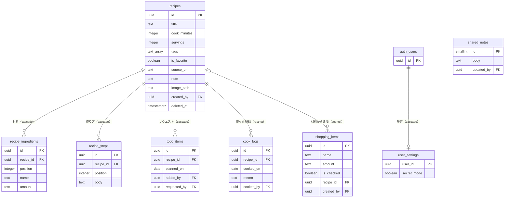

# DB 設計書（テーブル定義）

「なに食べたい？」の DB（Supabase の PostgreSQL）の**今の定義**をまとめたもの。正は [supabase/migrations/](../supabase/migrations/) のマイグレーションで、ここはそれを読みやすく書き起こしたもの。

「なぜそうしたか」は [HANDOFF.md](../HANDOFF.md) の 12（命名規則）・13（スキーマの判断・権限）・22（DB とのつなぎ方）を参照。

**マイグレーションを足したら、ここも一緒に直す。**

| マイグレーション | 中身 |
|---|---|
| `20261017175704_init.sql` | 初期スキーマ（7テーブル・DB 関数3つ・権限・RLS） |
| `20261018115231_revoke_unused_table_privileges.sql` | アプリで使わないテーブル権限（TRUNCATE など）を外す |
| `20261024023439_add_requests_and_user_settings.sql` | 「食べたい！」の列と関数、ユーザーごとの設定（`user_settings`） |

---

## 全体の方針

- **利用者は夫婦2人だけ**（新規登録は閉じている）。なので、ログインしていればデータは全部読み書きできる、を基本の権限にしている。例外は `user_settings`（自分の分だけ）と `shared_notes`（更新だけ）
- **複数のテーブルにまたがる書き込みは DB 関数にまとめる**。フロントから何回かに分けて書くと、途中で失敗したときに中途半端なデータが残るため
- **レシピは論理削除**（`deleted_at`）。作ったご飯の記録が参照しているため
- **日時は UTC**（`timestamptz`）、**日付は日本時間**（`date`。`cooked_on`・`planned_on`）
- 作成者の列（`created_by` など）の既定値は `auth.uid()`。フロントから渡さなくても、ログインしている人が入る

### 命名規則

| 対象 | ルール | 例 |
|---|---|---|
| テーブル | 複数形の snake_case、接尾辞なし | `recipes`、`cook_logs` |
| 列 | snake_case。外部キーは `<単数形>_id` | `recipe_id` |
| 日時・日付 | 日時は `_at`（timestamptz）、日付は `_on`（date） | `created_at`、`cooked_on` |
| ビュー（作る場合） | `_view` を付ける | — |

---

## ER 図

- `auth_users` は Supabase の認証のテーブル（`auth.users`）。図では `user_settings` との関係だけ描いた。作成者の列（`created_by`・`added_by`・`requested_by`・`cooked_by`・`updated_by`）も、すべて `auth.users (id)` を参照している
- 括弧の中は、レシピ（またはユーザー）を物理削除したときの動き。レシピは普段は論理削除なので、物理削除は確認用のデータを消すときなどに限られる
- `created_at`・`updated_at` は図では省略

---

## テーブル定義

「必須」は `not null`。✓ がないものは空（null）を許す。

### recipes：レシピ本体

| 列 | 型 | 必須 | 既定値 | 制約・説明 |
|---|---|---|---|---|
| `id` | uuid | ✓ | `gen_random_uuid()` | 主キー |
| `title` | text | ✓ | | 料理名。1〜100文字 |
| `cook_minutes` | integer | | | 調理時間（分）。1以上 |
| `servings` | integer | | | 何人分か。1以上 |
| `tags` | text[] | ✓ | `'{}'` | タグ（和食・豚肉など）。絞り込みに使う（GIN インデックス） |
| `is_favorite` | boolean | ✓ | `false` | お気に入り。夫婦で共通 |
| `source_url` | text | | | 参考 URL。URL から取り込んだときは自動で入る |
| `note` | text | | | ひとことメモ（作るときのコツや好み）。詳細画面で直接書き換える。`save_recipe` では触らない |
| `image_path` | text | | | Supabase Storage 上の写真のパス。写真の機能を作るまでは使わない |
| `created_by` | uuid | ✓ | `auth.uid()` | 作った人（`auth.users`） |
| `created_at` | timestamptz | ✓ | `now()` | |
| `updated_at` | timestamptz | ✓ | `now()` | 更新のたびにトリガーで自動更新 |
| `deleted_at` | timestamptz | | | 論理削除した日時。null なら有効 |

インデックス：`recipes_tags_idx`（`tags`、GIN）

### recipe_ingredients：材料（1行 = 1材料）

| 列 | 型 | 必須 | 既定値 | 制約・説明 |
|---|---|---|---|---|
| `id` | uuid | ✓ | `gen_random_uuid()` | 主キー |
| `recipe_id` | uuid | ✓ | | `recipes`。レシピを物理削除したら一緒に消える（cascade） |
| `position` | integer | ✓ | | 表示順（0 始まり）。`(recipe_id, position)` で一意 |
| `name` | text | ✓ | | 材料名。1〜100文字。★・(A) などの印は、名前の一部としてそのまま持つ |
| `amount` | text | ✓ | `''` | 分量（「300g」「大さじ1」など。文字のまま） |

インデックス：`recipe_ingredients_name_idx`（`name`。あとで「材料から検索」するため）

### recipe_steps：作り方（1行 = 1ステップ）

| 列 | 型 | 必須 | 既定値 | 制約・説明 |
|---|---|---|---|---|
| `id` | uuid | ✓ | `gen_random_uuid()` | 主キー |
| `recipe_id` | uuid | ✓ | | `recipes`（cascade） |
| `position` | integer | ✓ | | 手順の順番（0 始まり）。`(recipe_id, position)` で一意 |
| `body` | text | ✓ | | 手順の文。1文字以上 |

### todo_items：リクエスト（作る予定）

画面の名前は「リクエスト」。テーブル名は、最初の「今週作る」のときのまま。

| 列 | 型 | 必須 | 既定値 | 制約・説明 |
|---|---|---|---|---|
| `id` | uuid | ✓ | `gen_random_uuid()` | 主キー |
| `recipe_id` | uuid | ✓ | | `recipes`（cascade） |
| `planned_on` | date | | | 作る予定日（日本時間）。null なら日付未定 |
| `added_by` | uuid | ✓ | `auth.uid()` | 追加した人 |
| `requested_by` | uuid | | | 「🙋 食べたい！」をした人。null なら印なし。ユーザーが消えたら null（set null） |
| `created_at` | timestamptz | ✓ | `now()` | |

一意制約：`unique nulls not distinct (recipe_id, planned_on)`。同じ日に同じレシピは1つまで。「日付未定」どうしも同じとみなすので、日付未定の同じレシピも1つまで

インデックス：`todo_items_planned_on_idx`（`planned_on`）

### cook_logs：作ったご飯（記録）

| 列 | 型 | 必須 | 既定値 | 制約・説明 |
|---|---|---|---|---|
| `id` | uuid | ✓ | `gen_random_uuid()` | 主キー |
| `recipe_id` | uuid | ✓ | | `recipes`。**記録があるレシピは物理削除できない**（restrict） |
| `cooked_on` | date | ✓ | 今日（日本時間） | 作った日。既定値は `(now() at time zone 'Asia/Tokyo')::date` |
| `memo` | text | | | その回のメモ。「作ったご飯」の画面で、あれば表示する。書き込む画面はまだない（#25） |
| `cooked_by` | uuid | ✓ | `auth.uid()` | 作った人 |
| `created_at` | timestamptz | ✓ | `now()` | |

インデックス：`cook_logs_cooked_on_idx`（`cooked_on` の降順）、`cook_logs_recipe_id_idx`（`recipe_id`）

### shopping_items：買い物リスト

| 列 | 型 | 必須 | 既定値 | 制約・説明 |
|---|---|---|---|---|
| `id` | uuid | ✓ | `gen_random_uuid()` | 主キー |
| `name` | text | ✓ | | 品名。1〜100文字 |
| `amount` | text | | | 分量 |
| `is_checked` | boolean | ✓ | `false` | 買ったら true |
| `recipe_id` | uuid | | | リクエストの材料から追加したときの元のレシピ。手入力なら null。レシピが消えても行は残す（set null） |
| `created_by` | uuid | ✓ | `auth.uid()` | 追加した人 |
| `created_at` | timestamptz | ✓ | `now()` | |

### shared_notes：共有メモ（1行だけ）

| 列 | 型 | 必須 | 既定値 | 制約・説明 |
|---|---|---|---|---|
| `id` | smallint | ✓ | `1` | 主キー。`check (id = 1)` で1行しか作れない。最初の1行はマイグレーションで作ってある |
| `body` | text | ✓ | `''` | メモの本文 |
| `updated_by` | uuid | | `auth.uid()` | 最後に書き換えた人 |
| `updated_at` | timestamptz | ✓ | `now()` | 更新のたびにトリガーで自動更新 |

### user_settings：ユーザーごとの設定（1ユーザー1行）

行は、設定を初めて変えたときに作る。行がなければ、すべて既定値とみなす。

| 列 | 型 | 必須 | 既定値 | 制約・説明 |
|---|---|---|---|---|
| `user_id` | uuid | ✓ | `auth.uid()` | 主キー。`auth.users`。ユーザーが消えたら一緒に消える（cascade） |
| `secret_mode` | boolean | ✓ | `false` | シークレットモード。オンなら「リクエスト」のタブを出さない |
| `updated_at` | timestamptz | ✓ | `now()` | 更新のたびにトリガーで自動更新 |

---

## DB 関数

どれも `security invoker`（呼んだ人の権限で動き、RLS がそのまま効く）と `set search_path = ''`（同じ名前の偽のテーブルや関数へのすり替えを防ぐ）を付けている。1つの関数の中は1つのトランザクションになり、途中で失敗したら全部取り消される。

| 関数 | 引数 → 戻り値 | 中身 |
|---|---|---|
| `save_recipe` | レシピの id（null なら追加）、料理名、調理時間、何人分、タグ、参考 URL、材料（jsonb の配列）、手順（text の配列） → 保存したレシピの id | レシピの追加・編集。材料と手順は全部消して入れ直す。配列の順番がそのまま表示順になる。削除済みのレシピを編集しようとしたらエラー |
| `mark_cooked` | リクエストの id → 追加した `cook_logs` の行 | 「作った！」。リクエストから外して、作った記録を足す。記録する日は、予定日が今日以前ならその予定日（押し忘れ対策）、未来か未定なら今日 |
| `request_recipe` | レシピの id → 印を付けた（または追加した）`todo_items` の行 | 「🙋 食べたい！」。同じレシピが日付未定ですでにあれば、増やさずにその1件に印を付ける。なければ印付きで追加する |
| `add_todo_ingredients_to_shopping` | なし → 追加した件数 | リクエストに入っているレシピの材料を買い物リストに足す。同じレシピが何日かに入っていても1回分。同じレシピの同じ材料が、まだ買っていない状態であれば重ねて入れない |
| `set_updated_at` | トリガー専用 | `updated_at` を今の時刻にする。`recipes`・`shared_notes`・`user_settings` の更新前に動く |

---

## 権限

GRANT（テーブルや関数を使えるか）と RLS（どの行に触れるか）の2段で守っている。

### GRANT

| 対象 | anon（未ログイン） | authenticated（ログイン済み） |
|---|---|---|
| `recipes`・`recipe_ingredients`・`recipe_steps`・`todo_items`・`cook_logs`・`shopping_items` | なし | 読む・足す・変える・消す |
| `shared_notes` | なし | 読む・変える |
| `user_settings` | なし | 読む・足す・変える |
| DB 関数（`set_updated_at` 以外） | なし | 実行できる |
| `set_updated_at` | なし | なし（トリガーとしてだけ動く） |

- `service_role`（サーバー側の管理用）は、すべてのテーブルを読み書きでき、関数も実行できる（`set_updated_at` を除く）
- TRUNCATE・REFERENCES・TRIGGER・MAINTAIN は、anon と authenticated から外してある。これから作るテーブルにも付かない（2つ目のマイグレーション）

### RLS

すべてのテーブルで RLS を有効にしている。

| テーブル | ポリシー |
|---|---|
| `recipes`・`recipe_ingredients`・`recipe_steps`・`todo_items`・`cook_logs`・`shopping_items` | ログイン済みなら全操作できる |
| `shared_notes` | ログイン済みなら読める・書き換えられる（足す・消すはできない） |
| `user_settings` | 自分の行だけ読める・作れる・変えられる（`user_id = auth.uid()`） |

テストは [supabase/tests/](../supabase/tests/)（`04_privileges.sql` で権限、ほかのファイルで関数の動き）。新しいテーブルや関数を足すときのチェックは [HANDOFF.md](../HANDOFF.md) の 16。
