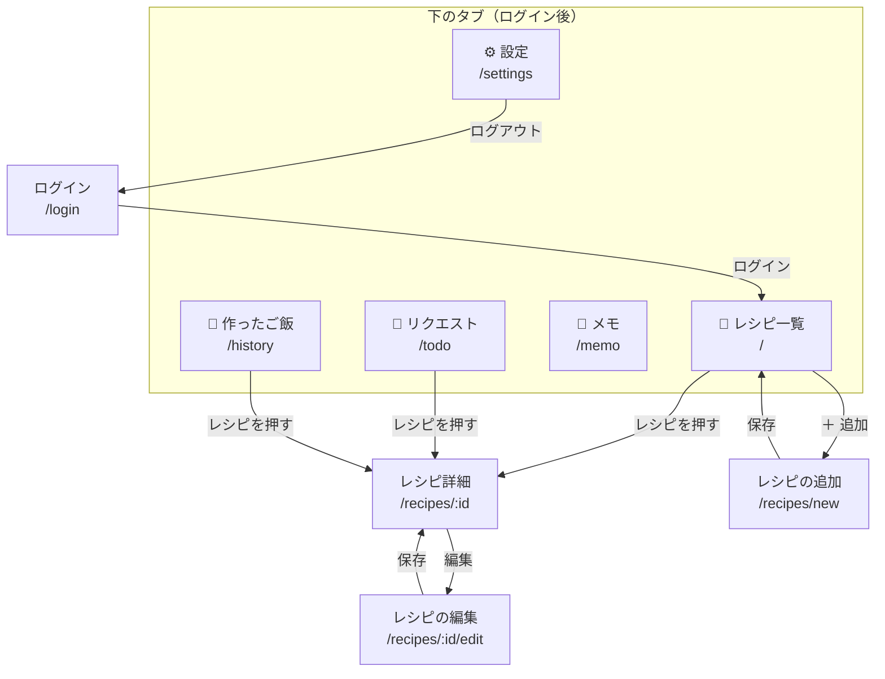

# 設計書

「なに食べたい？」の**今の作り**をまとめたもの。「なぜそうしたか・いつ決めたか」は [HANDOFF.md](../HANDOFF.md) に書き、ここからリンクする（同じ説明を二重に書かない）。

画面・DB・処理を変えたら、ここも一緒に直す。

> DB（ER 図・テーブル定義・DB 関数・権限）は [DATABASE.md](DATABASE.md) にまとめた。AI の読み取りは [HANDOFF.md](../HANDOFF.md) の 18 を参照。

---

## 画面の一覧と遷移

### 画面の一覧

| 画面 | パス | ファイル | 役割・主な操作 |
|---|---|---|---|
| ログイン | `/login` | `src/pages/Login/` | メールアドレスとパスワードでログイン。新規登録はない |
| レシピ一覧 | `/` | `src/pages/RecipeList/` | 検索、絞り込み（タグ・★ お気に入り・⏱ 20分以内）。レシピの追加へ進む |
| レシピ詳細 | `/recipes/:id` | `src/pages/RecipeDetail/` | 材料・作り方・ひとことメモ。お気に入り、リクエストに追加、編集へ進む |
| レシピの追加 | `/recipes/new` | `src/pages/RecipeForm/` | 入力して保存。AI で取り込む（URL・写真・テキスト） |
| レシピの編集 | `/recipes/:id/edit` | `src/pages/RecipeForm/` | 追加と同じ画面。中身を入れた状態で開く |
| リクエスト | `/todo` | `src/pages/Todo/` | 食べたい料理の一覧。カレンダーで作る日を決め、作ったら「作った！」 |
| メモ | `/memo` | `src/pages/Memo/` | 🛒 買い物リストと、夫婦で共有する 📝 メモ |
| 作ったご飯 | `/history` | `src/pages/History/` | 「作った！」の記録の一覧 |
| 設定 | `/settings` | `src/pages/Settings/` | ログイン中のメールアドレス、シークレットモード、バージョン、ログアウト |

ルートの定義は `src/App.tsx`。ログイン以外の画面は、下のタブ（`src/components/layout/MainLayout/`）の中に表示する。

### 遷移の図

タブどうしは、下のタブでいつでも行き来できる（図では省略）。

### 遷移のルール

| ルール | 内容 | 場所 |
|---|---|---|
| ログインしていないとき | ログイン以外の画面を開くと `/login` へ移す。ログインしたら、開こうとしていた画面へ戻す | `src/components/common/RequireAuth.tsx`、`src/pages/Login/` |
| 保存した後の移り先 | 追加したら一覧、編集したら詳細へ。どちらも履歴を置き換える（「戻る」でフォームに戻らない） | `src/pages/RecipeForm/`（理由は HANDOFF 18「保存した後の移り先」） |
| スクロールの位置 | 画面を移ったら一番上から見せる。「戻る」（iPhone の左端からのスワイプも）のときは、元の位置をブラウザに任せる | `src/components/layout/MainLayout/`（HANDOFF 18「保存した後は一番上から見せる」） |
| 詳細の「戻る」 | 来た画面（一覧・リクエスト・作ったご飯）へ戻る | `src/pages/RecipeDetail/` |
| シークレットモード | オンのときは「リクエスト」のタブを出さない。`/todo` を直接開いても一覧へ移す。設定を読み終わるまではタブも画面も出さない（一瞬でも予定が見えないように） | `MainLayout`、`src/pages/Todo/`（HANDOFF 15「予定日の表示をユーザーごとに分ける」） |
| レシピが見つからないとき | 詳細・編集で、消されたレシピなどを開くと「レシピ一覧へ」のリンクを出す | `src/pages/RecipeDetail/`、`src/pages/RecipeForm/` |
